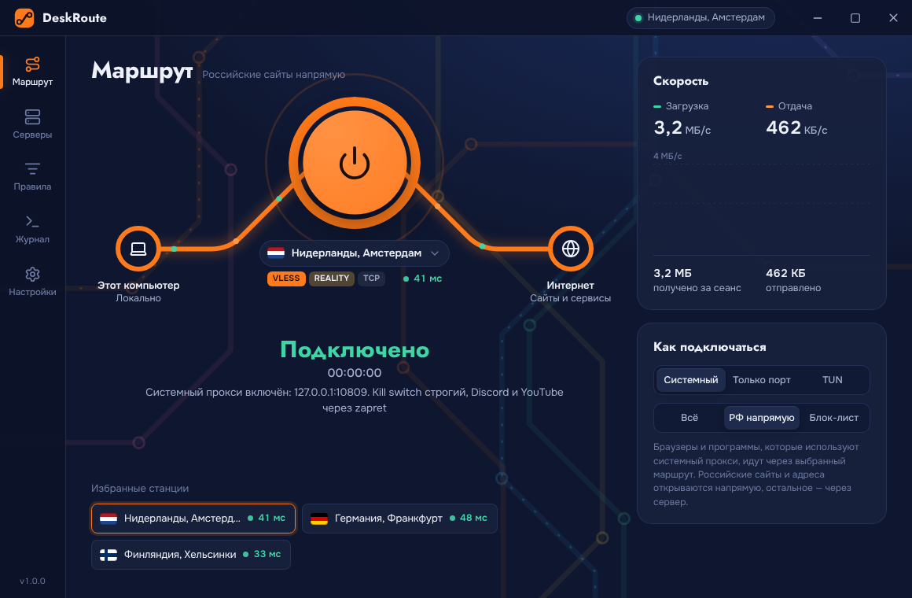
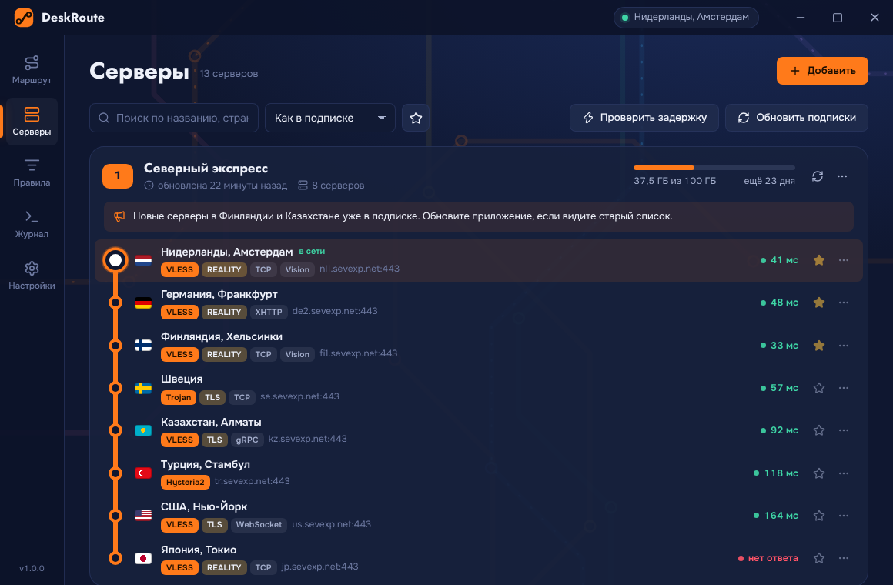
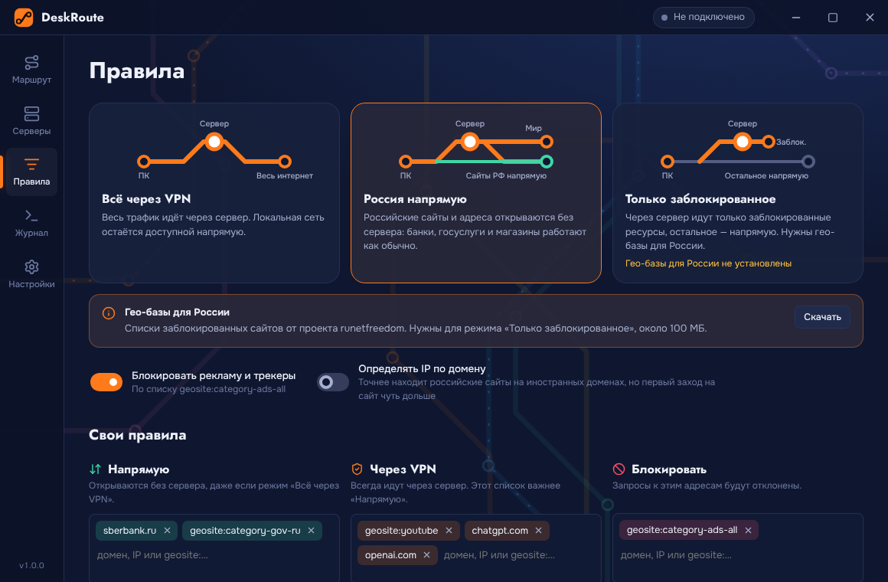
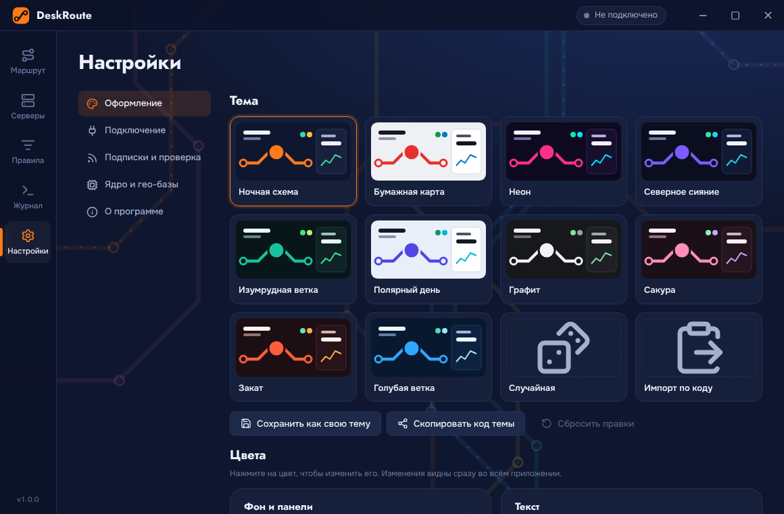
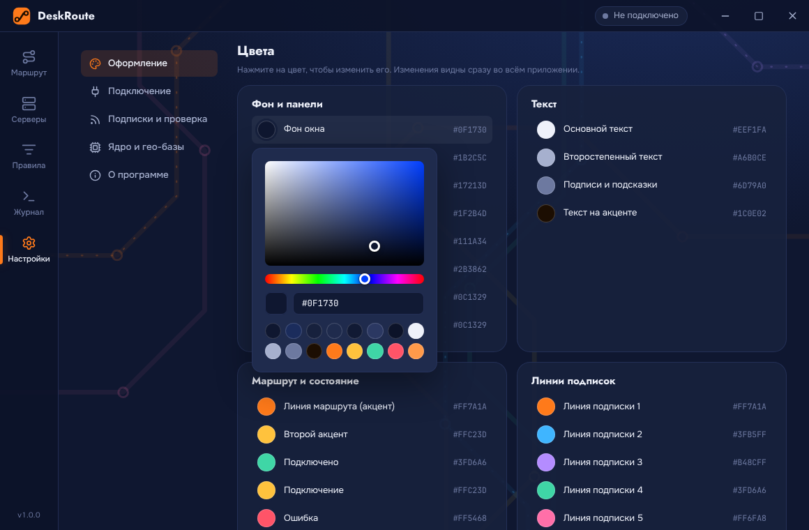
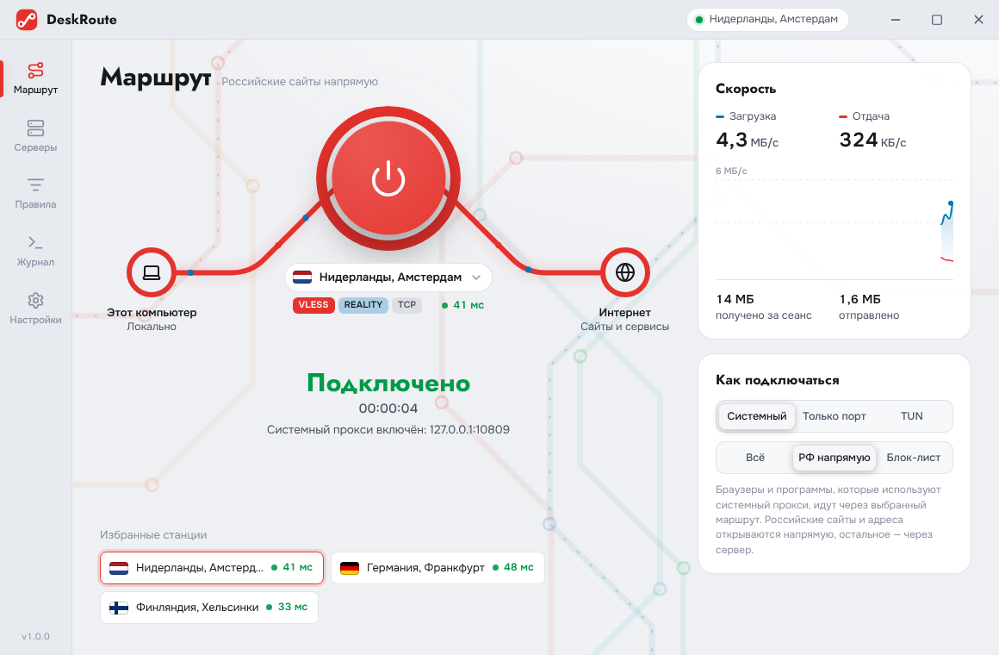
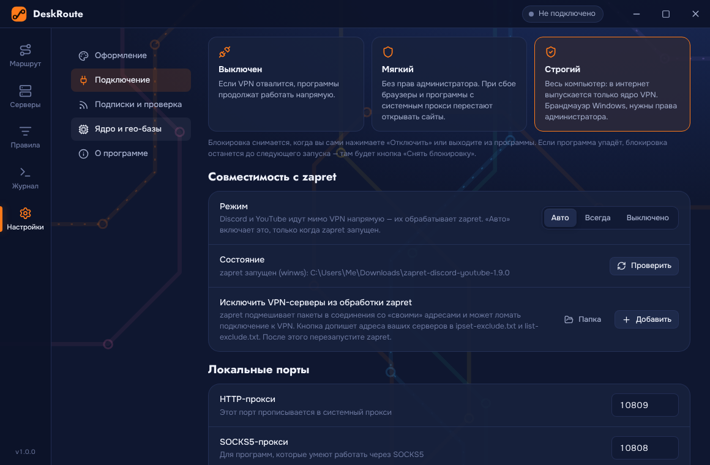
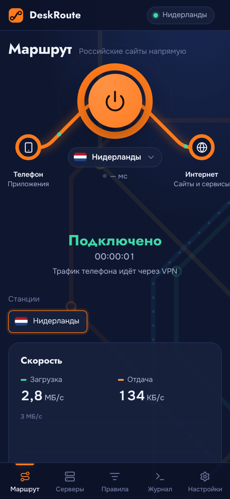
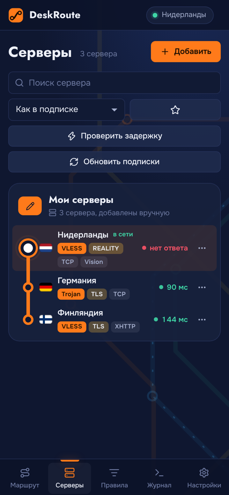
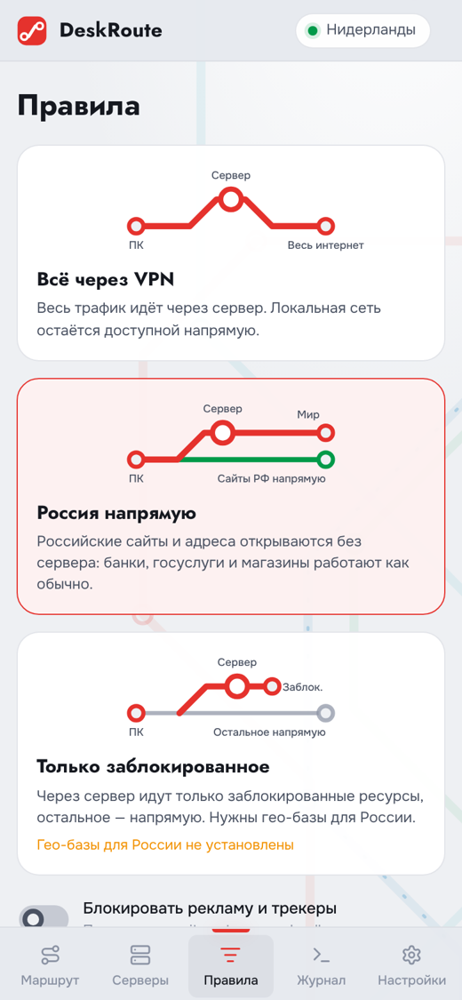

<p align="center">
  
</p>

<h1 align="center">DeskRoute</h1>

<p align="center">
  VPN-клиент для Windows, Linux и Android на ядре Xray: подписки, как в Happ, интерфейс в виде схемы метро и оформление, которое меняется целиком.
</p>

<p align="center">
  <a href="../../releases/latest"><b>Скачать последнюю версию</b></a> ·
  <a href="docs/INSTALL.md">Установка</a> ·
  <a href="docs/ANDROID.md">Android</a> ·
  <a href="docs/BUILD.md">Сборка из исходников</a> ·
  <a href="docs/FAQ.md">Вопросы и проблемы</a>
</p>



Добавляете ссылку на подписку от провайдера, выбираете сервер и нажимаете на кольцо. На главном экране виден ваш маршрут «компьютер → сервер → интернет»: точки на линии бегут быстрее, когда трафика больше. Подписки в списке серверов выглядят как линии метро, а серверы — как станции на них.

## Возможности

**Подключение**
- Протоколы: VLESS (REALITY, Vision, XHTTP, WebSocket, gRPC, HTTPUpgrade, mKCP), VMess, Trojan, Shadowsocks (AEAD и 2022), SOCKS5, Hysteria2.
- Подписки base64 и списками ссылок, JSON-конфиги Xray (Remnawave, Marzban). Показываются трафик, срок действия, объявления провайдера и ссылки на поддержку. Обновление при запуске и по расписанию.
- Режимы: системный прокси, только локальный порт (HTTP 10809, SOCKS5 10808), TUN для всего трафика компьютера.
- TUN без ручного перезапуска: в Windows DeskRoute сам получает права администратора и подключается (окно UAC только один раз), в Linux ядру один раз выдаются сетевые права.
- Реальная задержка через ядро или TCP-пинг, избранное, поиск, QR-коды для обмена, смена сервера без отключения.

**Защита**
- **Kill switch.** Мягкий — без прав администратора, держит системный прокси при сбое. Строгий — на весь компьютер: в Windows через брандмауэр, в Linux через nftables. В интернет выпускается только ядро VPN.
- **Совместимость с zapret / zapret-discord-youtube.** Discord (включая голос) и YouTube идут мимо VPN, и их обрабатывает zapret. В Linux zapret не трогает соединение с VPN-сервером, в Windows адреса серверов добавляются в исключения zapret одной кнопкой. Подробнее — в [FAQ](docs/FAQ.md#zapret).

**Маршрутизация**
- Готовые схемы: всё через VPN, «Россия напрямую», только заблокированное (гео-базы runetfreedom).
- Свои списки «Напрямую», «Через VPN», «Блокировать» с подсказками `geosite:` и `geoip:`; блокировка рекламы. Изменения применяются на лету.

**Оформление**
- 10 готовых тем, редактор всех 25 цветов интерфейса, случайная тема, свои темы и обмен ими по коду.
- Скругления, толщина линий маршрута, прозрачность и размытие панелей, свечение, скорость анимаций, масштаб, шрифты, фон: схема, сетка, звёзды, сияние или своя картинка.

| | |
|---|---|
|  |  |
|  |  |
|  |  |

## Быстрый старт

**Windows 10/11 (x64)**: скачайте со страницы [релизов](../../releases/latest) установщик `DeskRoute-Setup-<версия>.exe`, портативный `DeskRoute-Portable-<версия>.exe` или архив `DeskRoute-<версия>-windows-x64.zip`. Ядро Xray уже внутри.
Если появится «Windows защитила ваш компьютер», нажмите «Подробнее» → «Выполнить в любом случае»: у сборки нет платной цифровой подписи.

**Arch Linux и другие дистрибутивы (x86_64)**
```sh
tar -xzf DeskRoute-<версия>-linux-x64.tar.gz
cd DeskRoute-*/
./install.sh
```
DeskRoute появится в меню приложений; из терминала он запускается командой `deskroute`. Есть и AppImage — один файл, для него в Arch нужен пакет `fuse2`.

**Android 7+**: скачайте `DeskRoute-<версия>-android-arm64.apk` (подходит почти всем телефонам) или `…-android-universal.apk`, установите и откройте. Подробнее — в [docs/ANDROID.md](docs/ANDROID.md).

<p>
  
  
  
</p>

Потом нажмите «Добавить», вставьте ссылку на подписку и подключайтесь. Подробно — в [docs/INSTALL.md](docs/INSTALL.md).

## Сборка из исходников

```sh
npm install
npm start          # запуск без сборки
npm run dist:win   # установщик и портативная версия для Windows
npm run dist:linux # tar.gz и AppImage для Linux
```
Нужен Node.js 22. Подробности — в [docs/BUILD.md](docs/BUILD.md). Релизы собирает GitHub Actions: достаточно запушить тег вида `v1.2.0` и положить описание в `docs/release-notes/v1.2.0.md`.

## Устройство

```
src/main/        главный процесс Electron: подключение, подписки, ядро, системный прокси, kill switch, zapret
src/preload/     мост между окном и главным процессом
src/renderer/    интерфейс на HTML, CSS и JS без фреймворков и сборщиков (общий для всех платформ)
android/         приложение для Android: VPN-сервис на libv2ray и мост к интерфейсу
test/            тесты разбора ссылок и сквозной тест через настоящее ядро Xray
```

Проверки: `npm test` — разбор ссылок; `XRAY_BIN=путь/к/xray npm run test:e2e` поднимает локальный сервер Xray и прогоняет через клиент 14 вариантов протоколов.

## Лицензии

Код DeskRoute распространяется по лицензии [MIT](LICENSE). Ядро [Xray-core](https://github.com/XTLS/Xray-core) — MPL-2.0, для Android — [AndroidLibXrayLite](https://github.com/2dust/AndroidLibXrayLite). Иконки [Lucide](https://lucide.dev) — ISC. Шрифты Onest, Jost, Inter и JetBrains Mono — SIL OFL 1.1. Гео-базы: [Loyalsoldier/v2ray-rules-dat](https://github.com/Loyalsoldier/v2ray-rules-dat), [runetfreedom/russia-v2ray-rules-dat](https://github.com/runetfreedom/russia-v2ray-rules-dat).

DeskRoute — клиент: он не предоставляет серверы и подписки, их выдаёт ваш провайдер.
