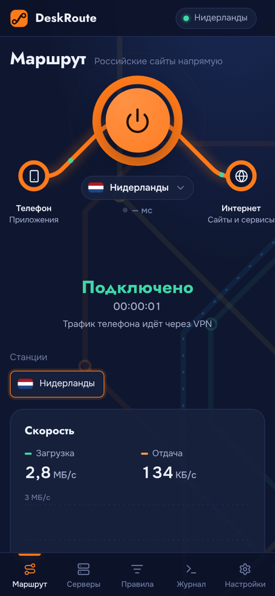
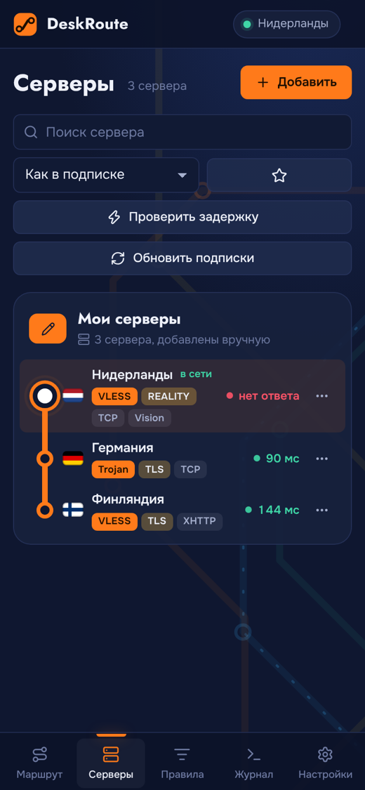
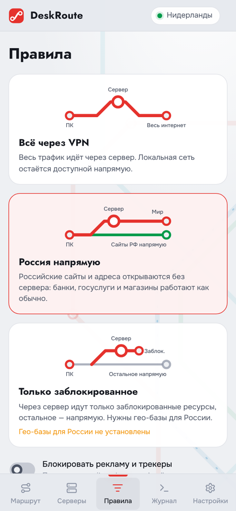

# DeskRoute для Android

Те же подписки, серверы, правила и оформление, что и на компьютере, но в виде VPN-приложения для телефона. Ядро — Xray-core 26 (библиотека [AndroidLibXrayLite](https://github.com/2dust/AndroidLibXrayLite)).

<p>
  
  
  
</p>

## Какой APK скачать

На странице [релизов](../../../releases/latest) лежат четыре файла:

| Файл | Для чего |
|---|---|
| `DeskRoute-<версия>-android-arm64.apk` | почти все телефоны 2017 года и новее — **берите этот** |
| `DeskRoute-<версия>-android-arm32.apk` | старые и бюджетные телефоны на 32-битном процессоре |
| `DeskRoute-<версия>-android-universal.apk` | если не знаете, какой нужен: работает везде, но весит больше |
| `DeskRoute-<версия>-android-x86_64.apk` | эмуляторы и редкие планшеты на Intel |

Нужен Android 7.0 или новее.

## Установка

1. Скачайте APK на телефон и откройте его.
2. Если Android попросит, разрешите браузеру или файловому менеджеру «Установку из неизвестных источников».
3. Откройте DeskRoute, нажмите «Добавить» и вставьте ссылку на подписку.

Ссылкой можно и поделиться: долгое нажатие на ссылку `vless://…` или на подписку → «Поделиться» → DeskRoute. Ссылки `deskroute://` и `vless://`, `vmess://`, `trojan://`, `ss://`, `hy2://` открываются в DeskRoute напрямую.

## Первое подключение

При первом нажатии на кольцо Android спросит разрешение на подключение к VPN — нажмите «ОК». Пока VPN включён, в шторке висит уведомление DeskRoute с кнопкой «Отключить».

## Kill switch на Android

На Android это делает сама система:
1. Настройки → Сеть и интернет → VPN (или DeskRoute → Настройки → Подключение → «Открыть»).
2. Нажмите на шестерёнку рядом с DeskRoute.
3. Включите «Постоянная VPN» и «Блокировать соединения без VPN».

Теперь VPN будет запускаться сам при включении телефона, а если соединение оборвётся, интернет не пойдёт мимо сервера.

## Что работает так же, как на компьютере

- подписки (base64, списки ссылок, JSON-конфиги), трафик и срок действия, объявления провайдера;
- все протоколы: VLESS (REALITY, Vision, XHTTP, WebSocket, gRPC), VMess, Trojan, Shadowsocks, SOCKS5, Hysteria2;
- правила «Всё через VPN» и «Россия напрямую», свои списки «Напрямую», «Через VPN», «Блокировать», блокировка рекламы;
- проверка задержки, избранное, QR-коды для обмена серверами;
- все темы, редактор цветов, обмен темами по коду.

## Отличия от версии для компьютера

- Трафик всех приложений идёт через VPN Android. Отдельного режима «системный прокси» нет. Внутри телефона на `127.0.0.1:10808` (SOCKS5) и `127.0.0.1:10809` (HTTP) работает и локальный прокси.
- Сам DeskRoute ходит в интернет напрямую, мимо VPN: так загружаются подписки и проверяется задержка.
- Режим «Только заблокированное» пока недоступен: во встроенных гео-базах нет списка заблокированных в России сайтов.
- Совместимости с zapret нет — на Android его обычно не используют.
- Ядро и гео-базы обновляются вместе с приложением, так что ставьте новые версии из релизов.

## Подпись приложения

APK подписаны ключом из репозитория (`android/keystore`), поэтому обновления ставятся поверх старой версии без удаления. Ключ публичный, поэтому подлинность APK проверяйте по `SHA256SUMS.txt` в релизе и скачивайте только отсюда. Чтобы подписывать своим ключом, задайте переменные `DR_KEYSTORE`, `DR_KEYSTORE_PASSWORD`, `DR_KEY_ALIAS`, `DR_KEY_PASSWORD` при сборке.

## Сборка

Нужны JDK 17, Android SDK (compileSdk 35), Gradle 8.10 и Node.js 22.

```sh
mkdir -p android/app/libs
curl -L -o android/app/libs/libv2ray.aar https://github.com/2dust/AndroidLibXrayLite/releases/download/v26.10.31/libv2ray.aar
unzip -o android/app/libs/libv2ray.aar assets/geosite.dat assets/geoip.dat -d /tmp/geo
node scripts/build-android-web.js /tmp/geo/assets/geosite.dat /tmp/geo/assets/geoip.dat
cd android
gradle assembleRelease
```

APK появятся в `android/app/build/outputs/apk/release/`. В релизах их собирает GitHub Actions вместе с версиями для Windows и Linux.

## Как устроено

- `android/app/src/main/java/…/DRVpnService.kt` создаёт VPN-интерфейс Android и передаёт его ядру Xray (`startLoop(config, tunFd)`). Само приложение исключено из VPN, чтобы соединения ядра с сервером не зацикливались.
- `MainActivity.kt` показывает тот же интерфейс, что на компьютере (WebView), и даёт ему мост `DRNative`: VPN, загрузку подписок, проверку задержки, буфер обмена.
- `android/web/backend.js` — логика приложения. Разбор ссылок, подписок и сборку конфигурации Xray она берёт из общих модулей `src/main`, тех же, что в десктопной версии.
